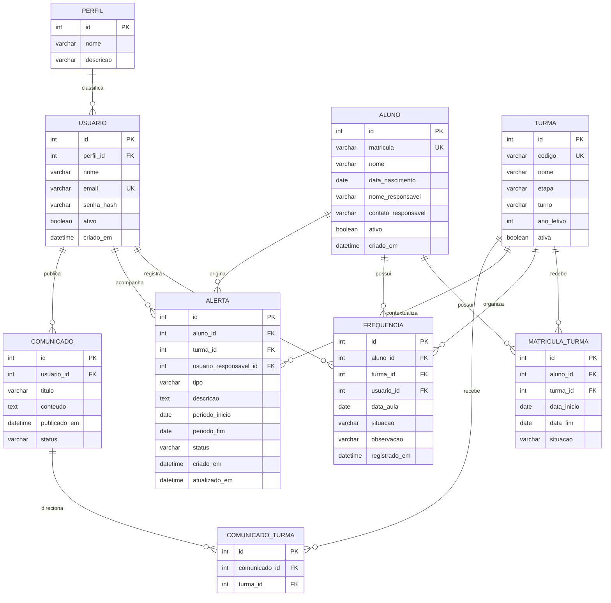

# Modelo de Dados — Tríade Digital

**Versão:** 0.1 — conceitual/lógico inicial  
**Marco:** 1  
**Status:** proposta; revisar após validação dos requisitos.

## 1. Premissas

- Banco relacional MySQL.
- Identificadores internos numéricos.
- Datas e horários registrados no banco.
- Usuários vinculados a perfis; autorização aplicada no servidor.
- Aluno pode possuir histórico de vínculo com turma, em vez de sobrescrever a turma anterior.
- Frequência registrada por aluno e data, associada à turma.
- Alertas devem preservar o motivo, o período analisado e o estado de acompanhamento.
- Dados fictícios durante desenvolvimento acadêmico.

## 2. Diagrama entidade-relacionamento

## 3. Regras e restrições preliminares

- `USUARIO.email` deve ser único.
- `ALUNO.matricula` deve ser única, se a instituição confirmar que a matrícula é identificador único e permanente.
- `FREQUENCIA` deve possuir restrição única para aluno + turma + data da aula, caso seja confirmado que existe apenas um registro diário por aluno/turma.
- `MATRICULA_TURMA` deve impedir vínculos simultâneos conflitantes para o mesmo aluno, conforme regra de transferência e rematrícula.
- Senhas armazenadas exclusivamente como hash seguro gerado pela aplicação.
- Operações de leitura e escrita devem respeitar perfil, escopo institucional e vínculo com turma.
- Inativação de aluno/usuário não deve apagar registros históricos.

## 4. Decisões ainda pendentes

1. A matrícula é globalmente única ou única por ano letivo/instituição?
2. Um aluno pode estar em mais de uma turma no mesmo período?
3. Frequência é diária ou por aula/horário?
4. Quais situações são permitidas: presente, falta, falta justificada, atraso, atividade remota?
5. Como registrar correção de frequência e manter trilha de auditoria?
6. Alertas serão gerados automaticamente ou inicialmente por consulta/regra executada pelo sistema?
7. Quais campos de responsável são necessários e autorizados?
8. Comunicados serão gerais, por turma ou por perfil?

## 5. Próxima etapa

Após validar as regras, converter este modelo em modelo lógico definitivo e script SQL de criação. Não utilizar dados reais de menores no ambiente acadêmico sem autorização institucional e controles adequados de privacidade e segurança.
